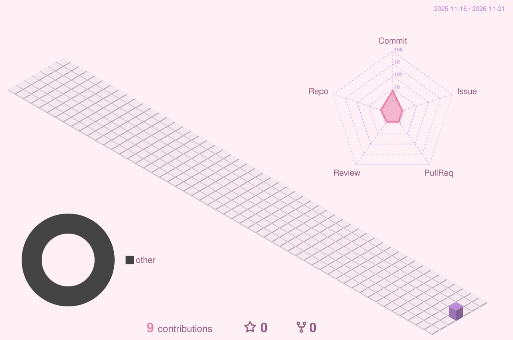

    

 

<table align="center">
<tr><td colspan="2" align="center"><b>♡ немного обо мне ♡</b></td></tr>
<tr><td>✿ сейчас</td><td>делаю музыкальный плеер для ПК</td></tr>
<tr><td>✿ люблю</td><td>пастельные цвета, музыку и красивые мелочи</td></tr>
<tr><td>✿ умею</td><td>десктопные приложения, iOS, уютные интерфейсы</td></tr>
<tr><td>✿ платформы</td><td>Windows · Linux · macOS · iOS</td></tr>
<tr><td>✿ пишите</td><td>если хотите сделать что-то красивое вместе</td></tr>
</table>

 

### ♡ мои инструменты

  

### ✿ мои дни в коде

### ♡ на связи

